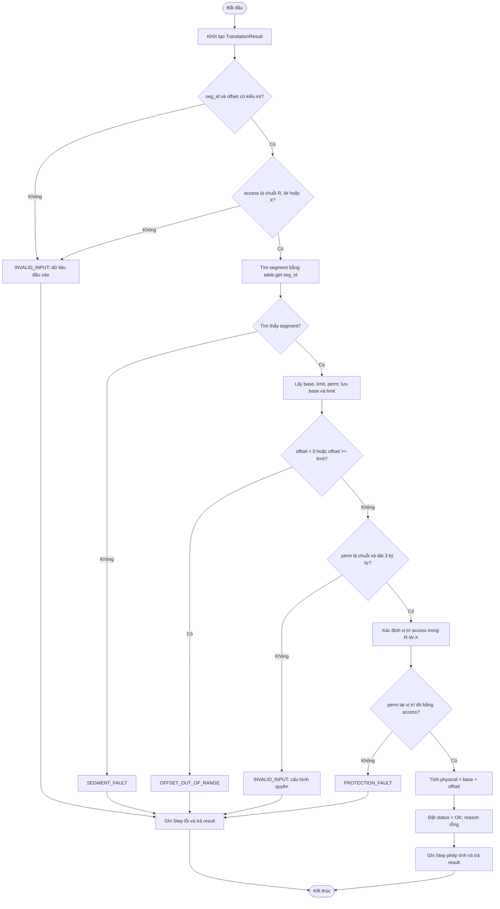
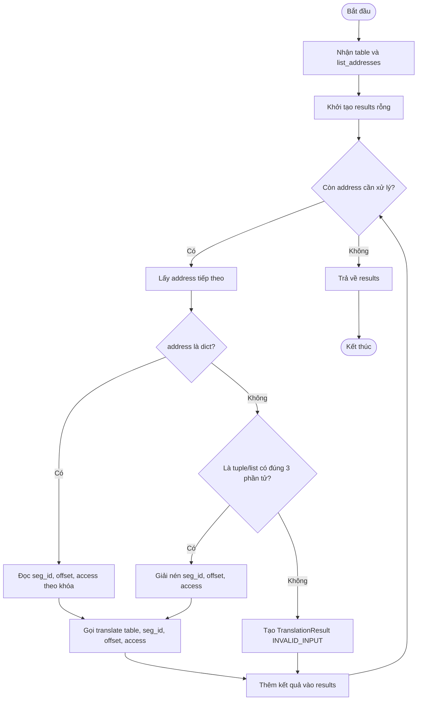

# TV2 – Pseudocode, Flowchart và bài toán mẫu tính tay (Trace)

**Dự án:** OS_MEM_12 – Segmentation và địa chỉ logic  
**Thành phần:** TV2 – Dịch địa chỉ logic sang địa chỉ vật lý  
**Mã nguồn đối chiếu:** `src/core/translator.py`, `src/core/result_types.py`, `input/segments.csv`, `input/addresses.csv`

---

## 1. Mục đích và phạm vi

Tài liệu trình bày thuật toán dịch địa chỉ logic sang địa chỉ vật lý theo cơ chế phân đoạn (Segmentation), gồm hai hàm:

- `translate(table, seg_id, offset, access)`: dịch một địa chỉ logic, kiểm tra dữ liệu đầu vào, tìm phân đoạn, kiểm tra giới hạn độ lệch, kiểm tra cấu hình quyền và quyền truy cập; đồng thời lưu các bước xử lý vào `steps`.
- `translate_many(table, list_addresses)`: xử lý lần lượt nhiều địa chỉ, hỗ trợ mỗi địa chỉ ở dạng `dict` hoặc bộ ba `tuple/list`, sau đó tổng hợp kết quả.

Chỉ khi địa chỉ hợp lệ và quyền truy cập được cho phép, chương trình mới tính địa chỉ vật lý theo công thức:

\[
Physical = Base + Offset
\]

### 1.1. Các trạng thái kết quả

Theo `Status` trong `src/core/result_types.py`, chương trình sử dụng 5 trạng thái:

| Trạng thái | Ý nghĩa |
|---|---|
| `OK` | Dịch địa chỉ thành công |
| `SEGMENT_FAULT` | Không tìm thấy `seg_id` trong bảng phân đoạn |
| `OFFSET_OUT_OF_RANGE` | `offset < 0` hoặc `offset >= limit` |
| `PROTECTION_FAULT` | Quyền truy cập không được cho phép |
| `INVALID_INPUT` | Dữ liệu đầu vào không đúng định dạng hoặc cấu hình quyền không hợp lệ |

### 1.2. Quy ước quyền truy cập

Chuỗi `perm` gồm 3 ký tự theo thứ tự **R–W–X**:

- Ký tự thứ nhất: quyền đọc (`R`) hoặc `-`.
- Ký tự thứ hai: quyền ghi (`W`) hoặc `-`.
- Ký tự thứ ba: quyền thực thi (`X`) hoặc `-`.

Ví dụ:

- `R-X`: cho phép đọc và thực thi.
- `RW-`: cho phép đọc và ghi.
- `R--`: chỉ cho phép đọc.

`access` chỉ nhận một trong ba giá trị chữ hoa: `R`, `W`, `X`.

---

## 2. Xây dựng Pseudocode (mã giả)

### 2.1. Thuật toán `translate()`

**Đầu vào:**
- `table`: bảng phân đoạn.
- `seg_id`: mã phân đoạn.
- `offset`: độ lệch trong phân đoạn.
- `access`: kiểu truy cập (`R`, `W` hoặc `X`).

**Đầu ra:** Một đối tượng `TranslationResult`, gồm thông tin địa chỉ đầu vào, `base`, `limit` (nếu tìm thấy phân đoạn), `physical` (nếu dịch thành công), `status`, `reason` và danh sách các bước `steps`.

```text
THUẬT TOÁN TRANSLATE(table, seg_id, offset, access)

BẮT ĐẦU
    result ← TranslationResult(seg_id, offset, access)

    // Bước 1: Kiểm tra dữ liệu đầu vào
    NẾU seg_id không phải kiểu int HOẶC offset không phải kiểu int
        result.status ← INVALID_INPUT
        result.reason ← "seg_id và offset phải là số nguyên"
        Thêm Step báo lỗi kiểm tra đầu vào vào result.steps
        TRẢ VỀ result
    KẾT THÚC NẾU

    NẾU access không phải chuỗi HOẶC access không thuộc {R, W, X}
        result.status ← INVALID_INPUT
        result.reason ← "Kiểu truy cập phải là R, W hoặc X"
        Thêm Step báo lỗi kiểu truy cập vào result.steps
        TRẢ VỀ result
    KẾT THÚC NẾU

    Thêm Step "Kiểm tra dữ liệu đầu vào: hợp lệ"

    // Bước 2: Tìm phân đoạn
    segment ← table.get(seg_id)

    NẾU segment không tồn tại
        result.status ← SEGMENT_FAULT
        result.reason ← "Không tìm thấy segment"
        Thêm Step báo không tìm thấy segment vào result.steps
        TRẢ VỀ result
    KẾT THÚC NẾU

    base ← segment.base
    limit ← segment.limit
    perm ← segment.perm

    result.base ← base
    result.limit ← limit
    Thêm Step ghi nhận thông tin segment vào result.steps

    // Bước 3: Kiểm tra giới hạn Offset
    NẾU offset < 0 HOẶC offset >= limit
        result.status ← OFFSET_OUT_OF_RANGE
        result.reason ← "Offset nằm ngoài giới hạn"
        Thêm Step kiểm tra offset thất bại vào result.steps
        TRẢ VỀ result
    KẾT THÚC NẾU

    Thêm Step kiểm tra offset hợp lệ vào result.steps

    // Bước 4: Kiểm tra cấu hình quyền
    NẾU perm không phải chuỗi HOẶC độ dài perm khác 3
        result.status ← INVALID_INPUT
        result.reason ← "Cấu hình quyền của segment không hợp lệ"
        Thêm Step báo cấu hình quyền không hợp lệ vào result.steps
        TRẢ VỀ result
    KẾT THÚC NẾU

    // Bước 5: Kiểm tra quyền truy cập
    permission_index ← vị trí của access trong {R, W, X}

    NẾU perm[permission_index] khác access
        result.status ← PROTECTION_FAULT
        result.reason ← "Segment không cho phép kiểu truy cập này"
        Thêm Step kiểm tra quyền bị từ chối vào result.steps
        TRẢ VỀ result
    KẾT THÚC NẾU

    Thêm Step kiểm tra quyền được cho phép vào result.steps

    // Bước 6: Tính địa chỉ vật lý
    result.physical ← base + offset
    result.status ← OK
    result.reason ← rỗng
    Thêm Step ghi lại phép tính Physical vào result.steps

    TRẢ VỀ result
KẾT THÚC
```

**Giải thích:** Chương trình kiểm tra kiểu dữ liệu trước khi tìm phân đoạn. Sau khi tìm thấy phân đoạn, chương trình kiểm tra giới hạn `offset`, sau đó kiểm tra cấu hình và quyền truy cập. Khi gặp lỗi, hàm gán trạng thái và lý do, ghi lại bước lỗi rồi trả kết quả ngay. Chỉ khi vượt qua tất cả bước kiểm tra, chương trình mới tính `physical = base + offset`.

**Lưu ý khi đối chiếu mã nguồn:** Trong `translator.py`, kiểm tra cấu hình `perm` ở hàm `translate()` hiện kiểm tra `perm` là chuỗi và có đúng 3 ký tự. Định dạng đầy đủ của chuỗi quyền (`R/-`, `W/-`, `X/-`) được kiểm tra ở bước đọc/kiểm định dữ liệu đầu vào của dự án.

### 2.2. Thuật toán `translate_many()`

**Đầu vào:**
- `table`: bảng phân đoạn.
- `list_addresses`: danh sách địa chỉ cần dịch. Mỗi phần tử có thể là:
  - `dict` có các khóa `seg_id`, `offset`, `access`; hoặc
  - `tuple/list` có đúng 3 phần tử `(seg_id, offset, access)`.

**Đầu ra:** Danh sách các đối tượng `TranslationResult`, theo đúng thứ tự địa chỉ đầu vào.

```text
THUẬT TOÁN TRANSLATE_MANY(table, list_addresses)

BẮT ĐẦU
    results ← danh sách rỗng

    DUYỆT từng address trong list_addresses
        THỬ
            NẾU address là dict
                seg_id ← address["seg_id"]
                offset ← address["offset"]
                access ← address["access"]

            NGƯỢC LẠI NẾU address là tuple hoặc list
                      VÀ có đúng 3 phần tử
                (seg_id, offset, access) ← address

            NGƯỢC LẠI
                Tạo TranslationResult có status = INVALID_INPUT
                Ghi lý do địa chỉ sai định dạng
                Thêm Step báo định dạng không hợp lệ
                Thêm kết quả vào results
                BỎ QUA phần tử hiện tại và chuyển sang phần tử kế tiếp
            KẾT THÚC NẾU

            result ← TRANSLATE(table, seg_id, offset, access)
            Thêm result vào results

        BẮT CÁC LỖI KeyError, TypeError hoặc ValueError
            Tạo TranslationResult có status = INVALID_INPUT
            Ghi lý do địa chỉ thiếu trường hoặc sai định dạng
            Thêm Step báo đọc dữ liệu địa chỉ không hợp lệ
            Thêm kết quả vào results
        KẾT THÚC THỬ
    KẾT THÚC DUYỆT

    TRẢ VỀ results
KẾT THÚC
```

Hàm `translate_many()` xử lý các địa chỉ theo thứ tự trong danh sách. Nếu một phần tử không đúng định dạng hoặc thiếu khóa cần thiết, hàm ghi nhận `INVALID_INPUT` cho phần tử đó và tiếp tục xử lý các phần tử còn lại, không dừng toàn bộ danh sách.

---

## 3. Xây dựng Flowchart (lưu đồ thuật toán)

Các lưu đồ dưới đây sử dụng cú pháp Mermaid. GitHub có thể hiển thị sơ đồ trực tiếp khi mở file Markdown có hỗ trợ Mermaid.

### 3.1. Lưu đồ thuật toán `translate()`

Lưu đồ mô tả lần lượt các bước: khởi tạo kết quả, kiểm tra kiểu dữ liệu, tìm phân đoạn, kiểm tra giới hạn `offset`, kiểm tra cấu hình quyền, kiểm tra quyền truy cập và tính địa chỉ vật lý.

**Hình 1. Lưu đồ thuật toán dịch một địa chỉ logic (`translate()`).**



### 3.2. Lưu đồ thuật toán `translate_many()`

Lưu đồ mô tả vòng lặp duyệt danh sách. Mỗi phần tử được phân loại theo dạng `dict` hoặc `tuple/list` có 3 phần tử. Nếu đúng định dạng, hàm gọi `translate()`. Nếu sai định dạng hoặc phát sinh một trong các lỗi được bắt, hàm tạo kết quả `INVALID_INPUT`. Sau đó, kết quả được thêm vào danh sách và vòng lặp tiếp tục.

**Hình 2. Lưu đồ thuật toán xử lý nhiều địa chỉ logic (`translate_many()`).**



---

## 4. Bài toán mẫu tính tay (Trace)

### 4.1. Dữ liệu đầu vào thực tế của dự án

Dữ liệu được đọc trực tiếp từ `input/segments.csv`.

| Seg_id | Base | Limit | Perm | Ý nghĩa quyền |
|---:|---:|---:|:---:|---|
| 0 | 1000 | 400 | R-X | Đọc và thực thi |
| 1 | 2000 | 1000 | RW- | Đọc và ghi |
| 2 | 3500 | 500 | R-- | Chỉ đọc |

Trong đó:

- `Base`: địa chỉ bắt đầu của phân đoạn trong bộ nhớ vật lý.
- `Limit`: kích thước phân đoạn.
- `Perm`: chuỗi quyền truy cập theo thứ tự `R–W–X`.

**Điều kiện hợp lệ của Offset:**

\[
0 \leq Offset < Limit
\]

**Công thức dịch địa chỉ:**

\[
Physical = Base + Offset
\]

### 4.2. Bảy địa chỉ được chọn để tính tay

Các trường hợp dưới đây đều có trong `input/addresses.csv`. Chúng được chọn để minh họa các nhánh xử lý quan trọng: dịch thành công, sai quyền, vượt giới hạn và không tìm thấy phân đoạn.

| STT trong tài liệu | Dòng dữ liệu trong CSV | Seg_id | Offset | Access |
|---:|---:|---:|---:|:---:|
| 1 | 1 | 0 | 100 | R |
| 2 | 3 | 0 | 399 | X |
| 3 | 5 | 0 | 200 | W |
| 4 | 4 | 0 | 400 | R |
| 5 | 7 | 1 | 500 | W |
| 6 | 14 | 2 | 10 | W |
| 7 | 17 | 3 | 10 | R |

### 4.3. Tính tay từng trường hợp

#### Trường hợp 1: `(seg_id=0, offset=100, access=R)`

- Segment 0 tồn tại: `Base = 1000`, `Limit = 400`, `Perm = R-X`.
- Kiểm tra Offset: \(0 \leq 100 < 400\), hợp lệ.
- Kiểm tra quyền: `R` được cho phép vì ký tự thứ nhất của `R-X` là `R`.
- Tính địa chỉ vật lý: \(Physical = 1000 + 100 = 1100\).
- **Kết quả:** `Status = OK`, `Physical = 1100`.

#### Trường hợp 2: `(seg_id=0, offset=399, access=X)`

- Segment 0 tồn tại: `Base = 1000`, `Limit = 400`, `Perm = R-X`.
- Kiểm tra Offset: \(0 \leq 399 < 400\), hợp lệ.
- Kiểm tra quyền: `X` được cho phép vì ký tự thứ ba của `R-X` là `X`.
- Tính địa chỉ vật lý: \(Physical = 1000 + 399 = 1399\).
- **Kết quả:** `Status = OK`, `Physical = 1399`.

#### Trường hợp 3: `(seg_id=0, offset=200, access=W)`

- Segment 0 tồn tại: `Base = 1000`, `Limit = 400`, `Perm = R-X`.
- Kiểm tra Offset: \(0 \leq 200 < 400\), hợp lệ.
- Kiểm tra quyền: `W` không được cho phép vì ký tự thứ hai của `R-X` là `-`.
- Thuật toán dừng tại bước kiểm tra quyền truy cập.
- **Kết quả:** `Status = PROTECTION_FAULT`; `Physical` không có giá trị.

#### Trường hợp 4: `(seg_id=0, offset=400, access=R)`

- Segment 0 tồn tại: `Limit = 400`.
- Điều kiện hợp lệ là \(0 \leq Offset < Limit\).
- Với `Offset = 400`, điều kiện `400 < 400` sai. Offset bằng Limit đã nằm ngoài đoạn.
- Thuật toán dừng tại bước kiểm tra giới hạn.
- **Kết quả:** `Status = OFFSET_OUT_OF_RANGE`; `Physical` không có giá trị.

#### Trường hợp 5: `(seg_id=1, offset=500, access=W)`

- Segment 1 tồn tại: `Base = 2000`, `Limit = 1000`, `Perm = RW-`.
- Kiểm tra Offset: \(0 \leq 500 < 1000\), hợp lệ.
- Kiểm tra quyền: `W` được cho phép vì ký tự thứ hai của `RW-` là `W`.
- Tính địa chỉ vật lý: \(Physical = 2000 + 500 = 2500\).
- **Kết quả:** `Status = OK`, `Physical = 2500`.

#### Trường hợp 6: `(seg_id=2, offset=10, access=W)`

- Segment 2 tồn tại: `Base = 3500`, `Limit = 500`, `Perm = R--`.
- Kiểm tra Offset: \(0 \leq 10 < 500\), hợp lệ.
- Kiểm tra quyền: `W` không được cho phép vì ký tự thứ hai của `R--` là `-`.
- Thuật toán dừng tại bước kiểm tra quyền truy cập.
- **Kết quả:** `Status = PROTECTION_FAULT`; `Physical` không có giá trị.

#### Trường hợp 7: `(seg_id=3, offset=10, access=R)`

- Dữ liệu đầu vào có kiểu hợp lệ: `seg_id` và `offset` là số nguyên, `access = R`.
- Bảng phân đoạn chỉ có các segment 0, 1 và 2.
- Không tìm thấy segment 3.
- Thuật toán dừng tại bước tìm phân đoạn.
- **Kết quả:** `Status = SEGMENT_FAULT`; `Physical` không có giá trị.

### 4.4. Bảng tổng hợp bảy trường hợp Trace

| STT | Seg_id | Offset | Access | Base | Limit | Physical | Status |
|---:|---:|---:|:---:|---:|---:|---:|---|
| 1 | 0 | 100 | R | 1000 | 400 | 1100 | `OK` |
| 2 | 0 | 399 | X | 1000 | 400 | 1399 | `OK` |
| 3 | 0 | 200 | W | 1000 | 400 | — | `PROTECTION_FAULT` |
| 4 | 0 | 400 | R | 1000 | 400 | — | `OFFSET_OUT_OF_RANGE` |
| 5 | 1 | 500 | W | 2000 | 1000 | 2500 | `OK` |
| 6 | 2 | 10 | W | 3500 | 500 | — | `PROTECTION_FAULT` |
| 7 | 3 | 10 | R | — | — | — | `SEGMENT_FAULT` |

Trong các trường hợp lỗi, `Physical` không được tạo ra. Nếu không tìm thấy segment, `base` và `limit` cũng giữ giá trị `None` theo cấu trúc `TranslationResult`.

### 4.5. Đối chiếu toàn bộ `input/addresses.csv`

File `input/addresses.csv` có **18 dòng địa chỉ**. Bảng sau tổng hợp kết quả dự kiến theo đúng thứ tự kiểm tra và logic trong `translator.py`:

| Dòng CSV | Seg_id | Offset | Access | Physical | Status |
|---:|---:|---:|:---:|---:|---|
| 1 | 0 | 100 | R | 1100 | `OK` |
| 2 | 0 | 0 | R | 1000 | `OK` |
| 3 | 0 | 399 | X | 1399 | `OK` |
| 4 | 0 | 400 | R | — | `OFFSET_OUT_OF_RANGE` |
| 5 | 0 | 200 | W | — | `PROTECTION_FAULT` |
| 6 | 1 | 0 | R | 2000 | `OK` |
| 7 | 1 | 500 | W | 2500 | `OK` |
| 8 | 1 | 999 | R | 2999 | `OK` |
| 9 | 1 | 1000 | R | — | `OFFSET_OUT_OF_RANGE` |
| 10 | 1 | 1200 | R | — | `OFFSET_OUT_OF_RANGE` |
| 11 | 1 | 100 | X | — | `PROTECTION_FAULT` |
| 12 | 1 | -1 | R | — | `OFFSET_OUT_OF_RANGE` |
| 13 | 2 | 10 | R | 3510 | `OK` |
| 14 | 2 | 10 | W | — | `PROTECTION_FAULT` |
| 15 | 2 | 499 | R | 3999 | `OK` |
| 16 | 2 | 500 | R | — | `OFFSET_OUT_OF_RANGE` |
| 17 | 3 | 10 | R | — | `SEGMENT_FAULT` |
| 18 | 5 | 0 | R | — | `SEGMENT_FAULT` |

**Thống kê kết quả của 18 địa chỉ:**

| Trạng thái | Số lượng |
|---|---:|
| `OK` | 8 |
| `SEGMENT_FAULT` | 2 |
| `OFFSET_OUT_OF_RANGE` | 5 |
| `PROTECTION_FAULT` | 3 |
| `INVALID_INPUT` | 0 |
| **Tổng cộng** | **18** |

Các dòng 9, 10, 12 và 16 minh họa việc `offset` vượt giới hạn hoặc âm. Dòng 11 và 14 minh họa lỗi quyền truy cập. Dòng 17 và 18 minh họa trường hợp không tồn tại phân đoạn.

---

## 5. Kết luận

Thuật toán dịch địa chỉ theo cơ chế phân đoạn thực hiện kiểm tra dữ liệu đầu vào, tìm phân đoạn, kiểm tra giới hạn `offset`, kiểm tra cấu hình quyền và quyền truy cập trước khi tính địa chỉ vật lý. Khi tất cả điều kiện hợp lệ, địa chỉ vật lý được xác định theo công thức `Physical = Base + Offset`.

Hàm `translate_many()` hỗ trợ xử lý danh sách địa chỉ theo thứ tự đầu vào. Mỗi địa chỉ có kết quả riêng; địa chỉ sai định dạng được ghi nhận `INVALID_INPUT` mà không làm dừng toàn bộ quá trình.

Qua bảy trường hợp tính tay và bảng đối chiếu 18 dòng dữ liệu trong `input/addresses.csv`, có thể kiểm tra các nhánh thành công và lỗi của thuật toán. Kết quả này là cơ sở để đối chiếu với kết quả chạy chương trình và dữ liệu trace do hệ thống xuất ra.

---

## 6. Ghi chú đối chiếu mã nguồn

1. Các tên trạng thái trong tài liệu được giữ nguyên theo `src/core/result_types.py`: `OK`, `SEGMENT_FAULT`, `OFFSET_OUT_OF_RANGE`, `PROTECTION_FAULT`, `INVALID_INPUT`.
2. Thứ tự kiểm tra trong pseudocode được viết theo `src/core/translator.py`: kiểm tra kiểu dữ liệu đầu vào → tìm segment → kiểm tra offset → kiểm tra cấu hình quyền → kiểm tra quyền truy cập → tính địa chỉ vật lý.
3. `translate_many()` trong mã nguồn hỗ trợ `dict` hoặc `tuple/list` có đúng 3 phần tử và bắt các ngoại lệ `KeyError`, `TypeError`, `ValueError`.
4. Mã nguồn `translator.py` hiện thực hiện trực tiếp các bước kiểm tra trong hàm `translate()`; tài liệu mô tả theo đúng cách hiện thực này, không mô tả hàm `check_fault()` như một lời gọi bên trong `translate()`.
5. Bảng phân đoạn và 18 địa chỉ trong tài liệu được đối chiếu với hai tệp CSV có trong dự án ZIP.
