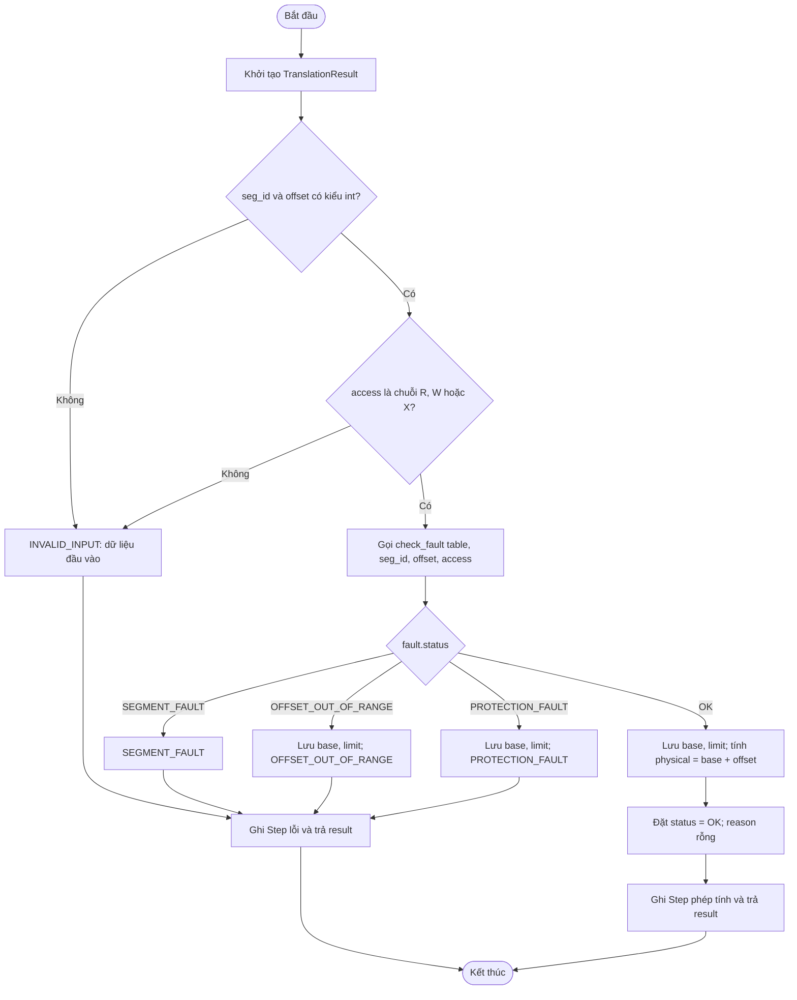
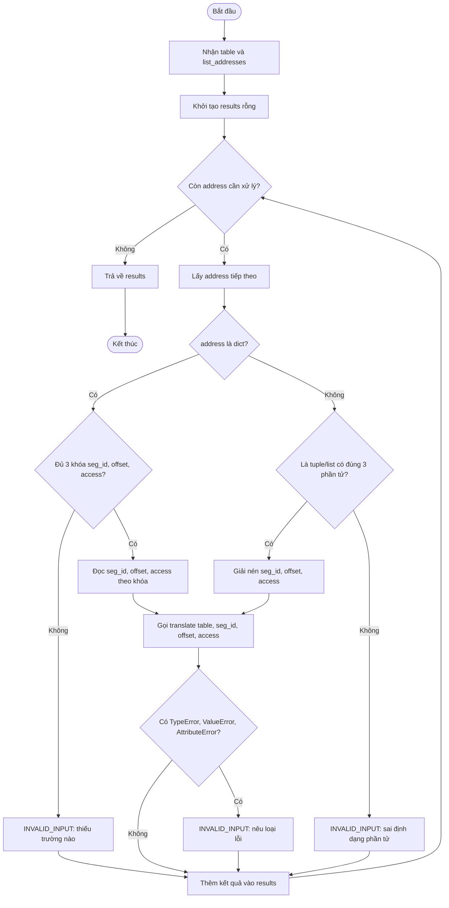

# Báo cáo Q2 – Thuật toán dịch địa chỉ: Pseudocode, Flowchart và Trace

**Dự án:** OS_MEM_12 – Segmentation và địa chỉ logic  
**Người thực hiện:** TV2 – Phạm Uyên Trang  
**Thành phần:** Dịch địa chỉ logic sang địa chỉ vật lý  
**Mã nguồn đối chiếu:** `src/core/translator.py`, `src/core/protection.py`, `src/core/result_types.py`, `input/segments.csv`, `input/addresses.csv`

---

## 1. Mục đích và phạm vi

Tài liệu trình bày thuật toán dịch địa chỉ logic sang địa chỉ vật lý theo cơ chế phân đoạn (Segmentation), gồm hai hàm:

- `translate(table, seg_id, offset, access)`: dịch một địa chỉ logic, kiểm tra kiểu dữ liệu đầu vào, gọi `protection.check_fault` (TV3) để xác định lỗi phân đoạn, giới hạn độ lệch hoặc quyền truy cập; đồng thời dựng và lưu các bước xử lý vào `steps`.
- `translate_many(table, list_addresses)`: xử lý lần lượt nhiều địa chỉ, hỗ trợ mỗi địa chỉ ở dạng `dict` hoặc bộ ba `tuple/list`, sau đó tổng hợp kết quả.

Chỉ khi địa chỉ hợp lệ và quyền truy cập được cho phép, chương trình mới tính địa chỉ vật lý theo công thức:

\[
Physical = Base + Offset
\]

### 1.1. Các trạng thái kết quả

Theo `Status` trong `src/core/result_types.py`, chương trình sử dụng 5 trạng thái:

| Trạng thái | Ý nghĩa |
|---|---|
| `OK` | Dịch địa chỉ thành công |
| `SEGMENT_FAULT` | Không tìm thấy `seg_id` trong bảng phân đoạn |
| `OFFSET_OUT_OF_RANGE` | `offset < 0` hoặc `offset >= limit` |
| `PROTECTION_FAULT` | Quyền truy cập không được cho phép |
| `INVALID_INPUT` | `seg_id`/`offset` không phải `int` hoặc `access` không thuộc `R`, `W`, `X` (hoặc phần tử địa chỉ trong `translate_many` sai định dạng) |

### 1.2. Quy ước quyền truy cập

Chuỗi `perm` gồm 3 ký tự theo thứ tự **R–W–X**:

- Ký tự thứ nhất: quyền đọc (`R`) hoặc `-`.
- Ký tự thứ hai: quyền ghi (`W`) hoặc `-`.
- Ký tự thứ ba: quyền thực thi (`X`) hoặc `-`.

Ví dụ:

- `R-X`: cho phép đọc và thực thi.
- `RW-`: cho phép đọc và ghi.
- `R--`: chỉ cho phép đọc.

`access` chỉ nhận một trong ba giá trị chữ hoa: `R`, `W`, `X`.

---

## 2. Xây dựng Pseudocode (mã giả)

### 2.1. Thuật toán `translate()`

**Đầu vào:**
- `table`: bảng phân đoạn.
- `seg_id`: mã phân đoạn.
- `offset`: độ lệch trong phân đoạn.
- `access`: kiểu truy cập (`R`, `W` hoặc `X`).

**Đầu ra:** Một đối tượng `TranslationResult`, gồm thông tin địa chỉ đầu vào, `base`, `limit` (nếu tìm thấy phân đoạn), `physical` (nếu dịch thành công), `status`, `reason` và danh sách các bước `steps`.

```text
THUẬT TOÁN TRANSLATE(table, seg_id, offset, access)

BẮT ĐẦU
    result ← TranslationResult(seg_id, offset, access)

    // Bước 0: Kiểm tra kiểu dữ liệu đầu vào (trước khi tra bảng segment)
    NẾU seg_id không phải kiểu int HOẶC offset không phải kiểu int
        result.status ← INVALID_INPUT
        result.reason ← "seg_id và offset phải là số nguyên"
        Thêm Step báo lỗi kiểm tra đầu vào vào result.steps
        TRẢ VỀ result
    KẾT THÚC NẾU

    NẾU access không phải chuỗi HOẶC access không thuộc {R, W, X}
        result.status ← INVALID_INPUT
        result.reason ← "Kiểu truy cập phải là R, W hoặc X"
        Thêm Step báo lỗi kiểu truy cập vào result.steps
        TRẢ VỀ result
    KẾT THÚC NẾU

    Thêm Step "Kiểm tra dữ liệu đầu vào: hợp lệ"

    // Bước 1-3: Xác định lỗi bằng protection.check_fault (TV3)
    fault ← CHECK_FAULT(table, seg_id, offset, access)
    result.status ← fault.status
    result.reason ← fault.reason

    // check_fault kiểm tra theo thứ tự: segment → offset → quyền

    NẾU fault.status = SEGMENT_FAULT
        Thêm Step báo không tìm thấy segment vào result.steps
        TRẢ VỀ result
    KẾT THÚC NẾU

    segment ← table.get(seg_id)
    result.base ← segment.base
    result.limit ← segment.limit
    Thêm Step ghi nhận thông tin segment vào result.steps

    NẾU fault.status = OFFSET_OUT_OF_RANGE      // offset < 0 HOẶC offset >= limit
        Thêm Step kiểm tra offset thất bại vào result.steps
        TRẢ VỀ result
    KẾT THÚC NẾU

    Thêm Step kiểm tra offset hợp lệ vào result.steps

    NẾU fault.status = PROTECTION_FAULT         // gồm cả perm sai định dạng
        Thêm Step kiểm tra quyền bị từ chối vào result.steps
        TRẢ VỀ result
    KẾT THÚC NẾU

    Thêm Step kiểm tra quyền được cho phép vào result.steps

    // Bước 4: Tính địa chỉ vật lý (fault.status = OK)
    result.physical ← result.base + offset
    Thêm Step ghi lại phép tính Physical vào result.steps

    TRẢ VỀ result
KẾT THÚC
```

**Giải thích:** `translate()` không tự viết lại logic kiểm tra lỗi mà gọi `check_fault()` trong `protection.py`; hàm này là nơi duy nhất quyết định `SEGMENT_FAULT`, `OFFSET_OUT_OF_RANGE` và `PROTECTION_FAULT`. Phần còn lại của `translate()` chỉ dựng danh sách `steps` tương ứng với trạng thái trả về, và tính `physical = base + offset` khi `status = OK`.

**Thứ tự kiểm tra (lưu ý khác với README mục "Thứ tự kiểm tra và trạng thái"):** README liệt kê 4 bước của `check_fault` (segment → offset → quyền → OK). `translate()` có thêm **bước 0** chạy trước: kiểm tra kiểu của `seg_id`, `offset`, `access`. Vì vậy một địa chỉ vừa có `access` sai (ví dụ `Q`) vừa có segment không tồn tại sẽ trả về `INVALID_INPUT`, không phải `SEGMENT_FAULT`. Bước 0 là cần thiết vì `check_fault` giả định kiểu đã đúng và sẽ ném `TypeError` nếu nhận chuỗi hoặc `None`.

**Cấu hình `perm` sai định dạng** (ví dụ `RWQ`, `RW`) không còn là `INVALID_INPUT`. `check_permission` từ chối cả chuỗi nên kết quả là `PROTECTION_FAULT`, thống nhất với README và `protection.py`. Trong luồng chạy thật, `csv_input.py` đã chặn các `perm` này khi đọc file.

### 2.2. Thuật toán `translate_many()`

**Đầu vào:**
- `table`: bảng phân đoạn.
- `list_addresses`: danh sách địa chỉ cần dịch. Mỗi phần tử có thể là:
  - `dict` có các khóa `seg_id`, `offset`, `access`; hoặc
  - `tuple/list` có đúng 3 phần tử `(seg_id, offset, access)`.

**Đầu ra:** Danh sách các đối tượng `TranslationResult`, theo đúng thứ tự địa chỉ đầu vào.

```text
THUẬT TOÁN TRANSLATE_MANY(table, list_addresses)

BẮT ĐẦU
    results ← danh sách rỗng

    DUYỆT từng address (đánh số i từ 1) trong list_addresses
        NẾU address là dict
            missing ← các khóa trong {seg_id, offset, access} mà address không có
            NẾU missing không rỗng
                Thêm INVALID_INPUT, reason = "Địa chỉ thứ i thiếu trường: <missing>"
                BỎ QUA phần tử hiện tại
            seg_id, offset, access ← address["seg_id"], address["offset"], address["access"]

        NGƯỢC LẠI NẾU address là tuple hoặc list VÀ có đúng 3 phần tử
            (seg_id, offset, access) ← address

        NGƯỢC LẠI
            Thêm INVALID_INPUT, reason = "Địa chỉ thứ i phải là dict hoặc bộ 3 (...)"
            BỎ QUA phần tử hiện tại
        KẾT THÚC NẾU

        THỬ
            Thêm TRANSLATE(table, seg_id, offset, access) vào results
        BẮT TypeError, ValueError, AttributeError
            Thêm INVALID_INPUT, reason nêu loại lỗi và nội dung lỗi
        KẾT THÚC THỬ
    KẾT THÚC DUYỆT

    TRẢ VỀ results
KẾT THÚC
```

Hàm `translate_many()` xử lý các địa chỉ theo thứ tự trong danh sách. Nếu một phần tử không đúng định dạng hoặc thiếu khóa, hàm ghi nhận `INVALID_INPUT` cho phần tử đó và tiếp tục xử lý các phần tử còn lại. Mỗi lỗi có `reason` riêng, nêu rõ số thứ tự phần tử và nguyên nhân: thiếu trường nào, sai kiểu phần tử, hoặc loại ngoại lệ phát sinh khi dịch.

---

## 3. Xây dựng Flowchart (lưu đồ thuật toán)

Các lưu đồ dưới đây sử dụng cú pháp Mermaid. GitHub có thể hiển thị sơ đồ trực tiếp khi mở file Markdown có hỗ trợ Mermaid.

### 3.1. Lưu đồ thuật toán `translate()`

Lưu đồ mô tả: khởi tạo kết quả, kiểm tra kiểu dữ liệu, gọi `check_fault` (kiểm tra segment, giới hạn `offset`, quyền truy cập theo thứ tự đó), rồi tính địa chỉ vật lý nếu `status = OK`.

**Hình 1. Lưu đồ thuật toán dịch một địa chỉ logic (`translate()`).**



### 3.2. Lưu đồ thuật toán `translate_many()`

Lưu đồ mô tả vòng lặp duyệt danh sách. Mỗi phần tử được phân loại theo dạng `dict` hoặc `tuple/list` có 3 phần tử. Nếu đúng định dạng, hàm gọi `translate()`. Nếu thiếu khóa, sai định dạng hoặc phát sinh một trong các lỗi được bắt, hàm tạo kết quả `INVALID_INPUT` kèm lý do cụ thể. Sau đó, kết quả được thêm vào danh sách và vòng lặp tiếp tục.

**Hình 2. Lưu đồ thuật toán xử lý nhiều địa chỉ logic (`translate_many()`).**



---

## 4. Bài toán mẫu tính tay (Trace)

### 4.1. Dữ liệu đầu vào thực tế của dự án

Dữ liệu được đọc trực tiếp từ `input/segments.csv`.

| Seg_id | Base | Limit | Perm | Ý nghĩa quyền |
|---:|---:|---:|:---:|---|
| 0 | 1000 | 400 | R-X | Đọc và thực thi |
| 1 | 2000 | 1000 | RW- | Đọc và ghi |
| 2 | 3500 | 500 | R-- | Chỉ đọc |

Trong đó:

- `Base`: địa chỉ bắt đầu của phân đoạn trong bộ nhớ vật lý.
- `Limit`: kích thước phân đoạn.
- `Perm`: chuỗi quyền truy cập theo thứ tự `R–W–X`.

**Điều kiện hợp lệ của Offset:**

\[
0 \leq Offset < Limit
\]

**Công thức dịch địa chỉ:**

\[
Physical = Base + Offset
\]

### 4.2. Bảy địa chỉ được chọn để tính tay

Các trường hợp dưới đây đều có trong `input/addresses.csv`. Chúng được chọn để minh họa các nhánh xử lý quan trọng: dịch thành công, sai quyền, vượt giới hạn và không tìm thấy phân đoạn.

| STT trong tài liệu | Dòng dữ liệu trong CSV | Seg_id | Offset | Access |
|---:|---:|---:|---:|:---:|
| 1 | 1 | 0 | 100 | R |
| 2 | 3 | 0 | 399 | X |
| 3 | 5 | 0 | 200 | W |
| 4 | 4 | 0 | 400 | R |
| 5 | 7 | 1 | 500 | W |
| 6 | 14 | 2 | 10 | W |
| 7 | 17 | 3 | 10 | R |

### 4.3. Tính tay từng trường hợp

#### Trường hợp 1: `(seg_id=0, offset=100, access=R)`

- Segment 0 tồn tại: `Base = 1000`, `Limit = 400`, `Perm = R-X`.
- Kiểm tra Offset: \(0 \leq 100 < 400\), hợp lệ.
- Kiểm tra quyền: `R` được cho phép vì ký tự thứ nhất của `R-X` là `R`.
- Tính địa chỉ vật lý: \(Physical = 1000 + 100 = 1100\).
- **Kết quả:** `Status = OK`, `Physical = 1100`.

#### Trường hợp 2: `(seg_id=0, offset=399, access=X)`

- Segment 0 tồn tại: `Base = 1000`, `Limit = 400`, `Perm = R-X`.
- Kiểm tra Offset: \(0 \leq 399 < 400\), hợp lệ.
- Kiểm tra quyền: `X` được cho phép vì ký tự thứ ba của `R-X` là `X`.
- Tính địa chỉ vật lý: \(Physical = 1000 + 399 = 1399\).
- **Kết quả:** `Status = OK`, `Physical = 1399`.

#### Trường hợp 3: `(seg_id=0, offset=200, access=W)`

- Segment 0 tồn tại: `Base = 1000`, `Limit = 400`, `Perm = R-X`.
- Kiểm tra Offset: \(0 \leq 200 < 400\), hợp lệ.
- Kiểm tra quyền: `W` không được cho phép vì ký tự thứ hai của `R-X` là `-`.
- Thuật toán dừng tại bước kiểm tra quyền truy cập.
- **Kết quả:** `Status = PROTECTION_FAULT`; `Physical` không có giá trị.

#### Trường hợp 4: `(seg_id=0, offset=400, access=R)`

- Segment 0 tồn tại: `Limit = 400`.
- Điều kiện hợp lệ là \(0 \leq Offset < Limit\).
- Với `Offset = 400`, điều kiện `400 < 400` sai. Offset bằng Limit đã nằm ngoài đoạn.
- Thuật toán dừng tại bước kiểm tra giới hạn.
- **Kết quả:** `Status = OFFSET_OUT_OF_RANGE`; `Physical` không có giá trị.

#### Trường hợp 5: `(seg_id=1, offset=500, access=W)`

- Segment 1 tồn tại: `Base = 2000`, `Limit = 1000`, `Perm = RW-`.
- Kiểm tra Offset: \(0 \leq 500 < 1000\), hợp lệ.
- Kiểm tra quyền: `W` được cho phép vì ký tự thứ hai của `RW-` là `W`.
- Tính địa chỉ vật lý: \(Physical = 2000 + 500 = 2500\).
- **Kết quả:** `Status = OK`, `Physical = 2500`.

#### Trường hợp 6: `(seg_id=2, offset=10, access=W)`

- Segment 2 tồn tại: `Base = 3500`, `Limit = 500`, `Perm = R--`.
- Kiểm tra Offset: \(0 \leq 10 < 500\), hợp lệ.
- Kiểm tra quyền: `W` không được cho phép vì ký tự thứ hai của `R--` là `-`.
- Thuật toán dừng tại bước kiểm tra quyền truy cập.
- **Kết quả:** `Status = PROTECTION_FAULT`; `Physical` không có giá trị.

#### Trường hợp 7: `(seg_id=3, offset=10, access=R)`

- Dữ liệu đầu vào có kiểu hợp lệ: `seg_id` và `offset` là số nguyên, `access = R`.
- Bảng phân đoạn chỉ có các segment 0, 1 và 2.
- Không tìm thấy segment 3.
- `check_fault` trả `SEGMENT_FAULT`; thuật toán dừng ngay, không xét offset và quyền.
- **Kết quả:** `Status = SEGMENT_FAULT`; `Physical` không có giá trị.

### 4.4. Bảng tổng hợp bảy trường hợp Trace

| STT | Seg_id | Offset | Access | Base | Limit | Physical | Status |
|---:|---:|---:|:---:|---:|---:|---:|---|
| 1 | 0 | 100 | R | 1000 | 400 | 1100 | `OK` |
| 2 | 0 | 399 | X | 1000 | 400 | 1399 | `OK` |
| 3 | 0 | 200 | W | 1000 | 400 | — | `PROTECTION_FAULT` |
| 4 | 0 | 400 | R | 1000 | 400 | — | `OFFSET_OUT_OF_RANGE` |
| 5 | 1 | 500 | W | 2000 | 1000 | 2500 | `OK` |
| 6 | 2 | 10 | W | 3500 | 500 | — | `PROTECTION_FAULT` |
| 7 | 3 | 10 | R | — | — | — | `SEGMENT_FAULT` |

Trong các trường hợp lỗi, `Physical` không được tạo ra. Nếu không tìm thấy segment, `base` và `limit` cũng giữ giá trị `None` theo cấu trúc `TranslationResult`.

### 4.5. Đối chiếu toàn bộ `input/addresses.csv`

File `input/addresses.csv` có **18 dòng địa chỉ**. Bảng sau tổng hợp kết quả dự kiến theo đúng thứ tự kiểm tra và logic trong `translator.py`:

| Dòng CSV | Seg_id | Offset | Access | Physical | Status |
|---:|---:|---:|:---:|---:|---|
| 1 | 0 | 100 | R | 1100 | `OK` |
| 2 | 0 | 0 | R | 1000 | `OK` |
| 3 | 0 | 399 | X | 1399 | `OK` |
| 4 | 0 | 400 | R | — | `OFFSET_OUT_OF_RANGE` |
| 5 | 0 | 200 | W | — | `PROTECTION_FAULT` |
| 6 | 1 | 0 | R | 2000 | `OK` |
| 7 | 1 | 500 | W | 2500 | `OK` |
| 8 | 1 | 999 | R | 2999 | `OK` |
| 9 | 1 | 1000 | R | — | `OFFSET_OUT_OF_RANGE` |
| 10 | 1 | 1200 | R | — | `OFFSET_OUT_OF_RANGE` |
| 11 | 1 | 100 | X | — | `PROTECTION_FAULT` |
| 12 | 1 | -1 | R | — | `OFFSET_OUT_OF_RANGE` |
| 13 | 2 | 10 | R | 3510 | `OK` |
| 14 | 2 | 10 | W | — | `PROTECTION_FAULT` |
| 15 | 2 | 499 | R | 3999 | `OK` |
| 16 | 2 | 500 | R | — | `OFFSET_OUT_OF_RANGE` |
| 17 | 3 | 10 | R | — | `SEGMENT_FAULT` |
| 18 | 5 | 0 | R | — | `SEGMENT_FAULT` |

**Thống kê kết quả của 18 địa chỉ:**

| Trạng thái | Số lượng |
|---|---:|
| `OK` | 8 |
| `SEGMENT_FAULT` | 2 |
| `OFFSET_OUT_OF_RANGE` | 5 |
| `PROTECTION_FAULT` | 3 |
| `INVALID_INPUT` | 0 |
| **Tổng cộng** | **18** |

Các dòng 9, 10, 12 và 16 minh họa việc `offset` vượt giới hạn hoặc âm. Dòng 11 và 14 minh họa lỗi quyền truy cập. Dòng 17 và 18 minh họa trường hợp không tồn tại phân đoạn.

---

## 5. Độ phức tạp và kiểm chứng

### 5.1. Độ phức tạp

| Hàm | Thời gian | Ghi chú |
|---|---|---|
| `translate()` | O(1) | Tra bảng segment bằng `dict`, so sánh `offset` với `limit`, truy cập một ký tự của `perm`, một phép cộng. |
| `translate_many()` | O(n) | n là số địa chỉ; mỗi địa chỉ xử lý độc lập bằng `translate()`. |

Bộ nhớ phụ của `translate()` là O(1) cho phần tính toán, cộng thêm danh sách `steps` có tối đa 5 bước cho mỗi địa chỉ.

### 5.2. Kiểm chứng bằng unit test

Các trường hợp tính tay ở mục 4 được kiểm tra tự động trong `src/tests/test_translator.py` (17 test):

| Nhóm kiểm thử | Nội dung |
|---|---|
| Dịch thành công | Địa chỉ hợp lệ cho `physical = base + offset`; các quyền `R`, `W`, `X` hợp lệ |
| Lỗi logic | `SEGMENT_FAULT`, `OFFSET_OUT_OF_RANGE` (offset âm và `offset = limit`), `PROTECTION_FAULT` |
| `INVALID_INPUT` | `seg_id`/`offset` sai kiểu (`str`, `None`, `float`, `bool`), `access` ngoài `R`, `W`, `X` |
| Thứ tự kiểm tra | `access` sai được kiểm tra trước khi tìm segment |
| Thống nhất với `protection.py` | `translate()` luôn cùng trạng thái với `check_fault()`; `perm` sai định dạng cho `PROTECTION_FAULT` |
| Ghi vết | Các bước có dấu tiếng Việt; bước lỗi có `ok = False` |
| `translate_many` | Giữ đúng thứ tự, nhận `dict` và `tuple`, thông báo lỗi nêu số thứ tự địa chỉ và trường thiếu, danh sách rỗng |

---

## 6. Kết luận

Thuật toán dịch địa chỉ theo cơ chế phân đoạn kiểm tra kiểu dữ liệu đầu vào, rồi dùng `check_fault` để kiểm tra phân đoạn, giới hạn `offset` và quyền truy cập trước khi tính địa chỉ vật lý. Khi tất cả điều kiện hợp lệ, địa chỉ vật lý được xác định theo công thức `Physical = Base + Offset`.

Hàm `translate_many()` hỗ trợ xử lý danh sách địa chỉ theo thứ tự đầu vào. Mỗi địa chỉ có kết quả riêng; địa chỉ sai định dạng được ghi nhận `INVALID_INPUT` mà không làm dừng toàn bộ quá trình.

Qua bảy trường hợp tính tay và bảng đối chiếu 18 dòng dữ liệu trong `input/addresses.csv`, có thể kiểm tra các nhánh thành công và lỗi của thuật toán. Kết quả này là cơ sở để đối chiếu với kết quả chạy chương trình và dữ liệu trace do hệ thống xuất ra.

---

## 7. Ghi chú đối chiếu mã nguồn

1. Các tên trạng thái trong tài liệu được giữ nguyên theo `src/core/result_types.py`: `OK`, `SEGMENT_FAULT`, `OFFSET_OUT_OF_RANGE`, `PROTECTION_FAULT`, `INVALID_INPUT`.
2. Thứ tự kiểm tra trong pseudocode theo `src/core/translator.py`: kiểm tra kiểu dữ liệu đầu vào (bước 0, `INVALID_INPUT`) → `protection.check_fault` (segment → offset → quyền) → tính địa chỉ vật lý. Bước 0 chạy trước nên khác README, vốn chỉ mô tả thứ tự của `check_fault`.
3. `translate_many()` hỗ trợ `dict` hoặc `tuple/list` có đúng 3 phần tử; thiếu khóa, sai định dạng hoặc lỗi ngoài dự kiến cho `INVALID_INPUT` với lý do riêng.
4. `translate()` gọi `check_fault()` và chỉ dựng `steps` từ kết quả; `perm` sai định dạng cho `PROTECTION_FAULT` (không còn `INVALID_INPUT`).
5. Bảng phân đoạn và 18 địa chỉ trong tài liệu được đối chiếu với hai tệp CSV có trong dự án ZIP.
